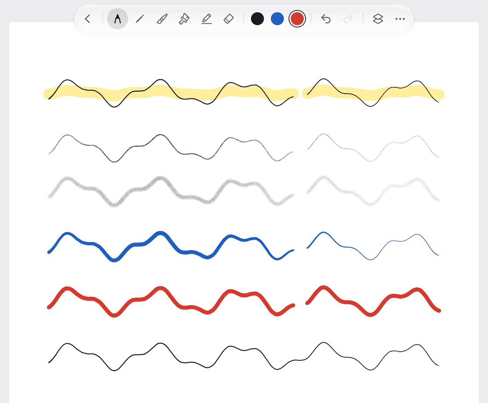

# noteitself

A minimalist note-taking and drawing app for iPad: notebooks, an infinite
canvas, PDF annotation and pixel art, built around low-latency Apple Pencil ink
that behaves like a pen on paper.

Native Swift, SwiftUI and Metal, with no third-party dependencies. iPadOS 17
or later.



## Build and run

Requires Xcode 27 and [XcodeGen](https://github.com/yonaskolb/XcodeGen)
(`brew install xcodegen`). The Xcode project is generated from `project.yml`
and is not checked in.

```sh
xcodegen generate          # creates noteitself.xcodeproj
open noteitself.xcodeproj
```

The simulator needs no further setup. To run on an iPad, give the build your
own signing team and bundle identifier:

```sh
cp Config/Local.xcconfig.example Config/Local.xcconfig   # then edit it
```

`Config/Local.xcconfig` is ignored by git. Then choose the iPad as the run
destination and press Run.

Tests (simulator):

```sh
xcodebuild test -scheme noteitself -destination 'platform=iOS Simulator,name=iPad Pro 11-inch (M5)'
Tools/ShaderCheck/run.sh   # validates the device ink shader on this Mac's GPU
```

If `xcodebuild` complains about the Command Line Tools, either run
`sudo xcode-select -s /Applications/Xcode.app/Contents/Developer` once, or prefix
commands with `DEVELOPER_DIR=/Applications/Xcode.app/Contents/Developer`.

The icon is the vector drawing `Tools/Icon/icon.svg`. After editing it, run
`uv run --with pillow python Tools/Icon/make_icon.py` to render it into the
asset catalog (needs `rsvg-convert`, from `brew install librsvg`).

## Using it

| Input | Does |
| --- | --- |
| Apple Pencil | Draws with the selected tool |
| Pencil double-tap | Switches to the eraser and back (configurable) |
| Pencil squeeze (Pencil Pro) | Previous tool (configurable) |
| Two fingers | Pan and pinch-zoom |
| Two-finger tap / three-finger tap | Undo / redo |
| One finger | Scroll, draw or erase — set in **… → Pencil & Touch** |
| Tap the selected tool | Size, paper feel, smoothing, natural ink, eraser mode |
| Tap the selected colour | Palette and custom colour |

One finger draws until the first Pencil touch is seen, then switches to
scrolling. With "One Finger: Erase" the Pencil writes and a fingertip rubs out.

**Image tracing:** *… → Add Image* places a half-transparent image layer under
the drawing layer. Drag to move it, drag a corner to resize, set its opacity,
tap **Done**, then draw over it. Hide or delete the image in the Layers panel.

**Pixel art:** *… → Canvas Size* sets any width and height from 1 to 256
pixels. The artwork is not scaled: the canvas grows or is cropped away from
the anchor you pick, and the change is one undo step.

**PDF:** *+ → Import PDF* (or "Open in noteitself" from Files) makes a notebook
whose pages are the PDF's pages. *… → Export PDF* writes vector ink over the
original vector pages.

## Writing feel

A stylus on glass has almost no friction: the tip skids as it lands and lifts,
runs past corners, and carries every tremor into the line. Plain smoothing
hides a little of that at the price of lag and melted corners. Each tool
instead has three independent controls:

- **Paper feel** (0–100 %) models what paper does to the tip.
  - *Grip:* the ink is dragged by dry friction that grows with pressure, so
    small movements of a resting or slowly moving tip do not move the line.
    The ink trails by a fixed fraction of a point, never by a time.
  - *Settling:* ink within a few points of the tip stays provisional and is
    averaged with its neighbours on both sides once the tip has moved on. That
    removes tremor with no lag. The average stops at corners.
  - *Skids and overshoot:* short, light, sharply angled skids at the start and
    end of a stroke are removed, and loops too small to be deliberate (the tip
    running past a corner and swinging back) are folded into clean cusps.
- **Natural ink** (pen, brush, pencil) makes line weight follow the tip like
  real ink: a hairline as the tip lands and lifts, slightly heavier where it
  slows or dwells, lighter when it races, a tapered tail when it leaves while
  moving, and a round dot for a tap.
- **Smoothing** is the classic time-based filter, still available on top.

Until an Apple Pencil's first force measurement arrives, UIKit reports a
placeholder force that is the same on every stroke. `PencilForce` ignores it,
so a stroke swells in from a point instead of starting with a blob.

Paper feel at 0 % with natural ink off is exactly the original pipeline, for
comparison. `Tests/HandwritingFeelTests.swift` scores the pipelines on simulated
glass handwriting (`Sources/App/SyntheticHand.swift`); launching a debug build
with `-new notebook -demoFeel` draws the same sample through each of them.

What software cannot do is add physical resistance, or remove tremor from fast
strokes without lag or distortion. A matte "paper-feel" screen protector or a
higher-friction Pencil tip changes that at the source and combines well with
the above.

## Files

Notes live in the app's Documents folder (visible in the Files app under
*On My iPad → noteitself*). Each note is a package:

```
Name.noteitself/
  manifest.json          kind, page list, view position
  pages/<id>.bin         layers and strokes of one page (LZFSE-compressed when smaller)
  assets/                imported PDFs and images
  thumb.png
  pixel.json, pixel/     pixel-art documents only
```

## Code map

| Folder | Contents |
| --- | --- |
| `Sources/Model` | Document package, binary page format, library |
| `Sources/Ink` | `StrokeBuilder` (paper friction, settling, ink flow, curve fitting), vector eraser |
| `Sources/Render` | Metal renderer and shaders, GPU meshes, PDF/image textures, PDF export |
| `Sources/Canvas` | `CanvasView` (touch input, camera, gestures), `EditorSession` (tools, undo, layers) |
| `Sources/UI` | SwiftUI library, toolbar and panels |
| `Sources/Pixel` | Self-contained pixel-art editor |
| `Tests`, `UITests` | Unit tests (stroke pipeline, eraser, file format, pixel art) and UI tests |
| `Tools` | Icon renderer and an off-device check of the ink shader |
| `Config` | Shared build settings and the template for your signing settings |

### How the ink stays fast

- Every Pencil sample (240 Hz, via coalesced touches) takes about 0.6 µs on
  average (Release build in the iOS Simulator on an Apple M5 Mac, measured by
  `Tests/PerformanceTests.swift`). Predicted touches extend the stroke to where
  the tip is heading, and the provisional part of the line is redrawn every
  frame so it always reaches the tip.
- Finished content is baked into one screen-sized texture, rebuilt when the
  view moves or the page changes. A frame while writing copies that texture and
  draws only the stroke in progress, plus any layers above the one being drawn
  on, so its cost does not grow with how much ink lies below.
- Strokes are GPU-instanced segments with analytic anti-aliasing; a per-stroke
  coverage mask held in tile memory gives exact edges with no extra RAM.
- Pages load on demand and are released when far from view; PDF pages are
  rasterised off the main thread at exactly the zoom on screen.

## Contributing

Issues and pull requests are welcome. Please run the unit and UI tests before
sending a change; for anything that touches the ink shader, also run
`Tools/ShaderCheck/run.sh`. Real Apple Pencil reports (what felt wrong, with
which tool and settings) are especially useful, since the simulator cannot
reproduce Pencil pressure or timing.

## License

noteitself is released under the [MIT License](LICENSE). The one piece of
adapted third-party code is listed in [THIRD_PARTY_NOTICES.md](THIRD_PARTY_NOTICES.md).

Apple, iPad, iPadOS, Apple Pencil, Metal and SF Symbols are trademarks of
Apple Inc. This project is not affiliated with or endorsed by Apple.
